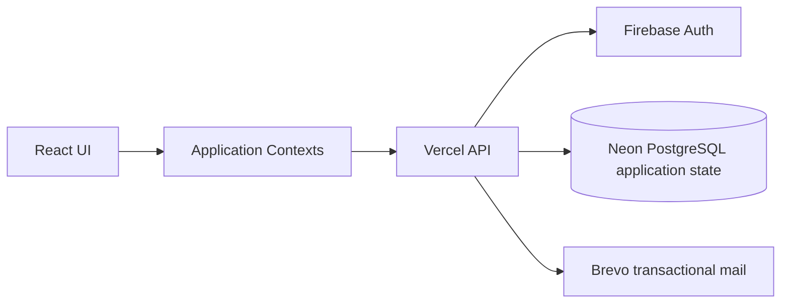

# System Overview

Last updated: 2026-10-12

Dopamine Dungeon is a multi-tenant campaign-management application for game
masters and players. This document is the current high-level architecture and
data-ownership reference. Testing semantics live in
[`docs/operations/TESTING.md`](../operations/TESTING.md); branch and CI policy
lives in [`docs/operations/REPOSITORY_POLICY.md`](../operations/REPOSITORY_POLICY.md).

## Core hierarchy

Workspace
|-- Campaign
    |-- Members
    |-- Sessions
    |-- Items and inventory
    |-- NPCs
    |-- Locations
    |-- Lore
    `-- PCs
        `-- Bag of Holding

Typed entity links connect active campaign entities. The retired standalone
Relationships page is not part of the product. Future PC-NPC and NPC-NPC
relationship behavior belongs to cross-linking and Friendship Index work.
`Arc`, `Quest`, and `Condition` remain reserved typed link endpoints, but their
former mock-backed pages are not active persisted product modules.

## Runtime layers

The full local application is run with `pnpm vercel dev`, which serves the
Vite frontend and Vercel API functions together. `pnpm dev` is frontend-only
and is not evidence that protected API or persistence workflows work.

## Identity and authentication

- Firebase Authentication establishes the authenticated identity.
- The Firebase UID is mapped to the application user and memberships. Email is
  not used to merge identities.
- Password users must complete email verification before protected server
  access. The server verifies Firebase ID tokens rather than trusting client
  state.
- Authentication tests use the guarded `demo-dopamine-dungeon` emulator setup;
  tests never use production Firebase or campaign data.

## Authorization and visibility

- Firebase UID resolves the application user; workspace and campaign
  memberships are separate records. The schema comments declare workspace
  roles `owner`, `gm`, `player` and campaign roles `gm`, `player`, but the
  columns are text and current workspace writers can persist `admin` or
  `member`. See the implementation-grounded
  [role and mode guide](../multitenant-multirole-management.md).
- Membership role is persisted authorization data. Selected GM/Player mode is
  a distinct request/UI context; it does not change the membership role.
  `canViewAsGm` requires campaign role `gm` and an explicit `X-DD-Mode: gm`;
  missing or unrecognized mode resolves to Player for handlers using this
  projection helper.
- Checks are endpoint-specific. Some reads filter the returned representation
  by mode; some writes require the GM role without checking selected mode,
  while Campaign Settings and invitations check both. This is not a claim that
  every handler enforces one uniform policy. Track broader authorization
  refinement in [#284](https://github.com/dopaminedungeon/dopamine-dungeon/issues/284).
- Client-side navigation filtering is a usability aid, not an authorization
  boundary. See the [permission guide](../multitenant-multirole-management.md)
  and test-layer detail in [`TESTING.md`](../operations/TESTING.md).

## Persistence ownership

Neon PostgreSQL, accessed through the Vercel API and Drizzle-backed
repositories, is the canonical store for application state, including users'
profile preferences, workspaces, campaigns, memberships, invitations, settings,
authentication-email limiter state, and core relational campaign entities:
sessions, items, inventory, NPCs, locations, lore, PCs, and typed
entity links. APIs and repositories are the persistence boundary. Campaign
and workspace scoping is implemented through endpoint-specific resolvers,
membership predicates, and scoped queries; do not infer that every route uses
the same workspace resolver or an identical predicate.

Firestore has no active application-state, transactional-mail, or auth-email
limiter runtime path. Historical migration/reconciliation scripts and retained
operational Firestore configuration still require explicit decommission gates;
Firebase Authentication and Firebase Storage remain intentional separate
services. The one-time, claim-gated Production audit reader was removed from
both `dev` and `main` by [PR #373](https://github.com/dopaminedungeon/dopamine-dungeon/pull/373)
and the `dev` source was verified by [PR #403](https://github.com/dopaminedungeon/dopamine-dungeon/pull/403).
Its route and implementation are not available. This was an operational
exception, not application-state ownership. The private #373 report could not
be located; the [#375 evidence ledger](FIRESTORE_TO_NEON_MIGRATION.md#375-production-evidence-ledger-reviewed-2026-10-12)
keeps later Production cutover, parity, rollback, deny-all canary, and physical
retirement gates unverified where records are absent. Do not repeat or perform
those operations from repository evidence alone. No new Firestore application
data writes should be introduced. ADR 0003 records the transition; the Neon
decision is bounded by ADR 0001.

## Environments and repository workflow

- Local development uses local credentials and `pnpm vercel dev`.
- Emulator-backed tests use the demo Firebase project and generated users.
- `dev` is the integration/preview branch. Feature branches target `dev`.
- `main` is the production deployment source. Development and production
  Firebase, Neon, and Vercel environments are separate.
- Optional `release/vX.Y` branches are short-lived stabilization branches.
  Hotfixes branch from `main` and return to `dev` after release validation.
- Agents do not merge PRs, deploy production, alter production data, or change
  remote branch protections. The exact target settings are documented in
  `docs/operations/REPOSITORY_POLICY.md`.

## Cross-cutting rules

- Campaign-owned records belong to a campaign and workspace. Each endpoint
  must use a verified scope and server-side membership check; a repository-wide
  guarantee is not inferred from the shared helpers alone.
- Protected API handlers authenticate and apply path-specific authorization.
  Tests and the role guide record verified predicates and gaps rather than
  treating UI visibility as proof.
- Player-hidden information must not be returned merely because the UI hides
  it.
- Schema changes require explicit migrations and rollback or mitigation notes.
- Production secrets and data are never used by local or automated tests.
