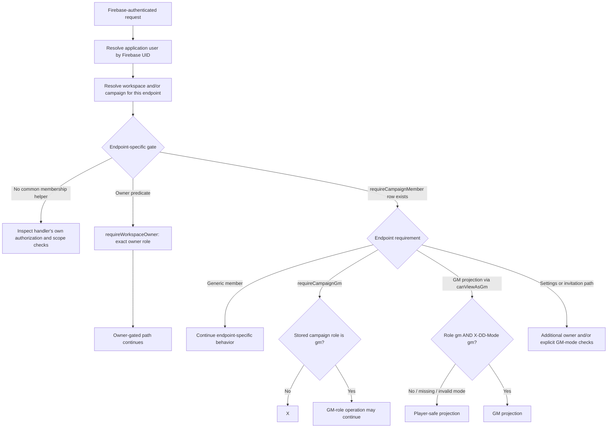

# Authorization Decision Paths (Implementation Snapshot)

This graph summarizes the helpers that are present, not a universal middleware
flow. Each endpoint may apply only the checks relevant to its path. See the
[verified authorization table](permissions-table.md) and the
[role/mode implementation guide](multitenant-multirole-management.md).

## Reading the graph

- Workspace owner operations use a separate check: `requireWorkspaceOwner`
  accepts only a workspace membership whose role is exactly `owner`.
- Campaign role and active mode are distinct. A campaign GM may select Player
  mode; handlers that call `canViewAsGm` then use the Player projection.
- The selected-mode check is not automatically applied to every handler.
  Several writes use `requireCampaignGm` alone; some other paths add a mode
  check. Never infer global mode denial from this diagram.
- The membership columns are text, while the schema comments declare workspace
  `owner`/`gm`/`player` and campaign `gm`/`player`. Workspace writers currently
  have additional `admin`/`member` behavior; see the implementation guide.
- Client-side routes and navigation are not an authorization boundary. API
  handlers and their queries must be assessed individually for scope,
  membership, and Player-safe response behavior.
